<p align="center">
  
</p>

<p align="center">
  <a href="https://github.com/Soneso/stellar-agent-wallet/actions/workflows/ci.yml"></a>
  <a href="https://crates.io/crates/stellar-agent-cli"></a>
  <a href="https://github.com/Soneso/stellar-agent-wallet/releases"></a>
  <a href="LICENSE"></a>
  <a href="docs/getting-started.md"></a>
  <a href="https://github.com/Soneso/stellar-agent-wallet/issues?q=is%3Aissue+is%3Aopen+label%3Aagent-ready"></a>
  <a href="https://soneso.com"></a>
</p>

# Stellar Agent Wallet

Stellar Agent Wallet lets an AI agent hold and move funds on Stellar inside
rules you set. Actions your rules mark as sensitive wait for your approval.
An audit log that you can check records transaction submissions, signed
authorizations, and approvals.

The wallet is for developers and operators who let an AI agent pay, trade, or
manage accounts on Stellar. It has two interfaces that share one core:

- The `stellar-agent` command-line tool. When it is on your `PATH`, the
  Stellar CLI also runs it as `stellar agent`.
- An MCP server, `stellar-agent-mcp`. MCP (Model Context Protocol) is the
  standard way an AI client such as Claude Code calls tools. The client starts
  the server as a subprocess and talks to it over standard input and output.

The project is a community experiment. AI agents write most of the code, and a
maintainer reviews every pull request. Soneso maintains the project under
[GOVERNANCE.md](GOVERNANCE.md). For a non-technical tour, read
[What is the Stellar Agent Wallet?](docs/onboarding.md).

## How you stay in control

The wallet gives you four controls over what an agent can do:

- Policy rules. Each profile, a named wallet configuration, has its own rules.
  A rule allows an action, refuses it, or holds it for your approval, for
  example a payment over a set amount.
- Approvals. A held action waits in your approval inbox until you approve or
  reject it. On testnet, you can answer in the terminal. On mainnet, you
  confirm with a passkey on a local web page or on a remote inbox. A remote
  inbox on mainnet needs an HTTPS address that your signed policy names.
  [Remote approval](docs/remote-approval.md) describes the remote inbox.
- Audit log. The wallet records transaction submissions, signed
  authorizations, approvals, and explicit key-management and lifecycle events
  in a hash-chained log. Each entry includes the hash of the entry before it.
  `stellar-agent audit verify <LOG_PATH> --profile <NAME>` checks the log, as
  [`audit verify`](docs/cli-reference/profile-and-governance.md#audit-verify-log_path)
  describes.
- Key custody. The wallet signs with keys from your operating system's
  keyring, or with a Ledger device from the CLI. On testnet, the CLI also
  reads a seed from an environment variable, as the quickstart shows. Mainnet
  refuses that. An agent that uses the MCP server gets no key through its
  tools. Approval separates you from the agent only when the agent cannot run
  commands as your operating-system user.

[Concepts](docs/concepts.md) explains each of these controls.
[Architecture](docs/architecture.md) shows the trust boundaries, the payment
flow, and where keys are kept.

## What it can do

- Send payments, check balances, and claim claimable balances (payments held
  on chain until the recipient collects them). Open trustlines, which let an
  account hold an issued asset such as USDC.
- Swap tokens on Soroswap, and deposit into or withdraw from DeFindex vaults.
- Deploy and govern OpenZeppelin smart accounts. These are on-chain accounts
  that can use passkeys as signers. You can give an agent its own key, limited
  to rules and spending caps that the contract enforces.
- Pay for HTTP APIs with the x402 tools of the MCP server. x402 is a scheme
  where a service asks for payment before it answers.
- Authorize sponsored charges of the Machine Payments Protocol (MPP) on
  testnet. In a sponsored charge, the service pays the network fee and submits
  the transaction.
- Work with anchors, the services that move money onto and off Stellar,
  through the SEP tools of the MCP server. The tools read an anchor's deposit
  and withdrawal options (SEP-6). They also return the link to its interactive
  deposit or withdrawal flow, which you open in a browser (SEP-24).
- Preview `web+stellar:` request links (SEP-7) with the same MCP tools. They
  also sign through the standard wallet interface (SEP-43), sign and verify
  messages (SEP-53), and discover the SEPs a contract claims (SEP-47). For a
  contract call, they show a preview with typed arguments from the contract's
  on-chain spec (SEP-48).
- Install signed toolsets. A toolset is a package that limits what an agent
  can call through the MCP tool `stellar_toolset_invoke`. Your policy and
  approvals govern the server's other tools.

[Protocols and integrations](docs/protocols.md) lists what the wallet does
with each standard and service, and
[Agent payments with MPP](docs/agent-payments.md) describes the MPP flow.

## Status

The wallet is a public alpha under active development. The
[milestones](https://github.com/Soneso/stellar-agent-wallet/milestones) list
the planned work for each release.

- Testnet is the default network. Without a saved profile, the MCP server and
  commands such as `pay`, `claim`, and `accounts create` use a temporary
  testnet setup.
- A default build, one with the project's default Cargo features, can sign
  and submit on mainnet. The release archives are default builds. First you
  complete the mainnet setup, which includes a dedicated mainnet profile and
  an enrolled signer, a signing key you store in the keyring. It also includes
  the `profile enable-mainnet` step, which binds this installation to the
  profile. Last, the policy owner's key signs a policy that lists your
  approval passkey.
  [Set up mainnet writes](docs/getting-started.md#set-up-mainnet-writes) lists
  every step. On mainnet, the CLI supports `pay`, `claim`, `trustline`, and
  `accounts create` in sponsored mode, where your account funds the new one.
  The MCP server supports the matching payment, claim, account, and trustline
  tools, and x402 payments. When the policy allows an action and the other
  mainnet checks pass, the wallet signs it without asking you. When the policy
  requires approval, the action waits until you confirm it with your passkey.
  The wallet refuses other writes on mainnet, such as smart-account, DeFi, and
  MPP operations and SEP-43 and SEP-53 signing.
  [Mainnet configurations and scope](docs/getting-started.md#mainnet-configurations-and-scope)
  lists the excluded operations and the error codes.
- Mainnet writes move real funds. The wallet is alpha software and comes
  without warranty under the Apache-2.0 license. Use mainnet at your own risk,
  and start with small amounts and tight policy limits.
- Friendbot, the free test-funds faucet, works on testnet and futurenet only.
  The wallet refuses it on mainnet.

Each tagged release publishes archives on the
[releases page](https://github.com/Soneso/stellar-agent-wallet/releases) and
the published crates on
[crates.io](https://crates.io/crates/stellar-agent-cli). A source build of the
`main` branch includes unreleased changes.

## Install

One executable, `stellar-agent`, holds the CLI and the MCP server. While only
alpha versions exist, spell out the version in `cargo install` and
`cargo binstall`. A bare crate name matches stable versions only.

### cargo binstall (prebuilt binaries)

The recommended path needs
[cargo-binstall](https://github.com/cargo-bins/cargo-binstall). It downloads
the prebuilt release archive for your platform:

```bash
cargo binstall --locked --disable-strategies quick-install,compile stellar-agent-cli@0.2.0-alpha.1
```

Start the MCP server with `stellar-agent mcp serve`. The executable also runs
the server when its file name is `stellar-agent-mcp`. If your MCP client
starts that name, copy the executable:

```bash
cp ~/.cargo/bin/stellar-agent ~/.cargo/bin/stellar-agent-mcp
```

### cargo install (from crates.io)

This path needs a Rust toolchain and the build tools that
[Prerequisites](docs/getting-started.md#prerequisites) lists. It builds from
the sources on crates.io:
`cargo install --locked stellar-agent-cli@0.2.0-alpha.1`. Make the same copy
if you need it.

### Build from source

A source build needs a Rust toolchain and the same build tools. Clone the
release tag and build with its committed `Cargo.lock`:

```bash
git clone --branch v0.2.0-alpha.1 https://github.com/Soneso/stellar-agent-wallet.git
cd stellar-agent-wallet
cargo build --release --locked
cp target/release/stellar-agent target/release/stellar-agent-mcp
```

The [direct download](docs/getting-started.md#download-an-archive-directly)
needs neither cargo-binstall nor a Rust toolchain.
[Install](docs/getting-started.md#install) also covers Windows and macOS, and
[Verifying releases](docs/verifying-releases.md) shows how to check an archive.

## Try it on testnet

These commands need no profile. Create an account and fund it from Friendbot:

```bash
stellar-agent accounts create --generate --fund-with-friendbot
```

The output holds the new account ID (it starts with `G`) and its secret seed
in `data.secret_key`. Save the seed for the payment step, and keep it out of
logs and shared terminals.

In the next commands, replace `GABC...WXYZ` with your new account ID. Replace
`GDEST...WXYZ` with the ID of the account you pay. Check the balances:

```bash
stellar-agent balances --account GABC...WXYZ
```

The payment reads the seed from the `WALLET_SK` variable. Run this line on its
own, paste the seed when prompted, and press Enter:

```bash
printf 'WALLET_SK seed: ' && read -rs WALLET_SK && echo && export WALLET_SK
```

Send 10 XLM, then remove the seed from the shell:

```bash
stellar-agent pay GDEST...WXYZ "10 XLM" --source GABC...WXYZ --secret-env WALLET_SK
unset WALLET_SK
```

[Pass a secret seed](docs/getting-started.md#pass-a-secret-seed) shows the
PowerShell steps and how to remove a seed from your shell history. By default,
each command prints one JSON object on standard output.
[Output envelope and exit codes](docs/cli-reference/index.md#output-envelope-and-exit-codes)
describes the output and the exit codes. To use policy rules and MCP signing,
create a saved profile with `stellar-agent profile init`, as
[Set up a profile](docs/getting-started.md#set-up-a-profile) describes.
[Getting started](docs/getting-started.md) continues from here, and the
[CLI reference](docs/cli-reference/index.md) lists every command, flag, and
output shape.

## Connect an AI agent

Point your MCP client at the server executable, `stellar-agent-mcp`. The
server offers tools for payments, DeFi, the SEP standards, x402, MPP,
smart-account rules, transaction status, and toolsets. The payment tools use
the same policy, approval, and audit libraries as the CLI.
[The MCP server](docs/mcp.md) covers client configuration and the tool
catalog. To teach your agent the wallet's commands and tools, install the
[agent skill](skills/README.md), which works in Claude Code and other agents.

## Documentation

The [documentation for users](docs/README.md#for-users) covers getting
started, concepts, the CLI and MCP references, protocols, toolsets, profiles,
and remote approval. The
[documentation for maintainers](docs/README.md#for-maintainers) covers the
crate architecture, building and testing, security internals, and reviews.

## Contribute

Give your coding agent [AGENTS.md](AGENTS.md), which tells it where to start.
Issues labeled
[`agent-ready`](https://github.com/Soneso/stellar-agent-wallet/issues?q=is%3Aissue+is%3Aopen+label%3Aagent-ready)
name the files to change and the commands that check the result. To claim an
unassigned
[`good first issue`](https://github.com/Soneso/stellar-agent-wallet/issues?q=is%3Aissue+is%3Aopen+label%3A%22good+first+issue%22)
or
[`help wanted`](https://github.com/Soneso/stellar-agent-wallet/issues?q=is%3Aissue+is%3Aopen+label%3A%22help+wanted%22)
issue, comment "I'll take this" on it. The release notes of each release name
its contributors.
[Start here with your agent](CONTRIBUTING.md#start-here-with-your-agent) has a
prompt for your agent and describes the review. Questions and ideas go to
[Discussions](https://github.com/Soneso/stellar-agent-wallet/discussions).

## Security and license

[SECURITY.md](SECURITY.md) lists the supported versions and explains how to
report a vulnerability. The license is Apache-2.0; see [LICENSE](LICENSE).

---

"Stellar" is a trademark of the Stellar Development Foundation.
This is an independent project, not affiliated with, sponsored, or endorsed by the Stellar Development Foundation.
