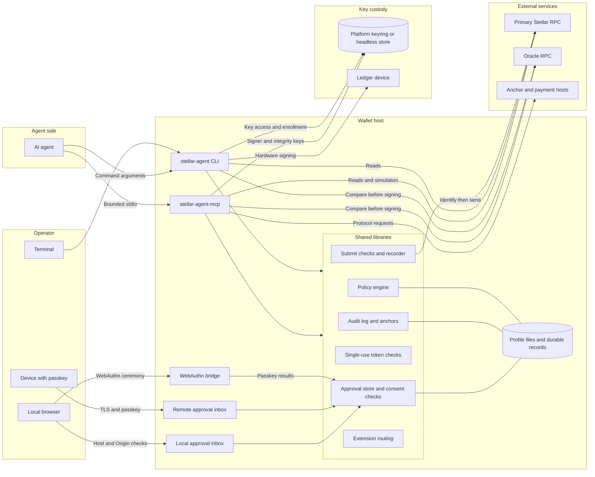
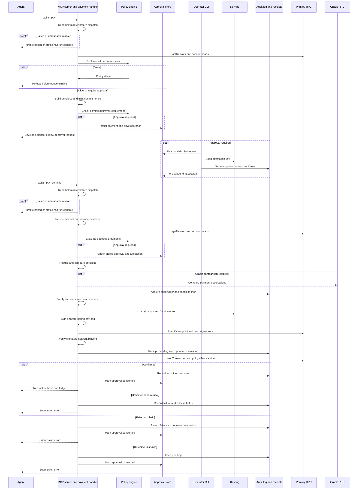

# Architecture

## What the wallet is

Stellar Agent Wallet is a self-custodial Stellar wallet for AI agents, with keys and permissions under the operator's control.
An agent uses the `stellar-agent` command-line interface or `stellar-agent-mcp`, which speaks the Model Context Protocol (MCP), a tool-call protocol, over standard input and output.
The operator configures policy and approves requests, while the host's keyring stores enrolled signing keys and integrity keys, secrets that authenticate records.
Payment handlers connect policy checks, required approvals, signing, and audit records to Stellar RPC, the network's remote request interface.
Testnet is the default, and mainnet writes are refused unconditionally.

## Actors and trust boundaries

The wallet checks agent input, operator consent, stored state, and network responses at separate boundaries.

A profile groups settings, key references, and records; each MCP process binds one profile at startup.
The diagram shows selected relationships, including shared library calls within each binary.
CLI `approve serve` runs the local inbox, or the remote inbox with `--remote`; `credentials add-passkey` starts the WebAuthn bridge.

| Boundary | What crosses it | Component that checks it |
| --- | --- | --- |
| Agent to wallet | Tool names and arguments | MCP transport limits each line to 1 MiB; handlers validate arguments and invoke policy gates. |
| Agent running CLI commands as the operator's OS user | Command arguments and approval requests | `approve --yes` checks only OS user identity; such an agent can approve its own requests. |
| Terminal to wallet | Approval identifier and confirmation | CLI renders the stored request and checks the operating-system user identity. |
| Local browser to wallet | Approval decisions and WebAuthn, the browser passkey protocol | Listeners bound to the host check Host and Origin headers; approval and passkey handlers validate the request. |
| Remote device to wallet | Encrypted requests and passkey assertions | Remote inbox requires TLS, a passkey session from an allowlisted credential, and a fresh assertion bound to the action. |
| Wallet to key store or Ledger | Key lookups or signing requests | Keyring adapters check key identity; Ledger signs on the device. |
| Libraries to local files | Signed policy, approvals, audit rows, receipts, and spending reservations | Policy signature loader, locked stores, and audit anchors check their respective records. |
| Wallet to RPC | Ledger reads, simulations, and signed transactions | Endpoint identity checks the server's network; signature binding verifies signatures against that network. An oracle, a second RPC endpoint, can compare observations. |
| Wallet to protocol hosts | Discovery, authentication, and payment artifacts | Protocol adapters enforce URL and request bindings. |

The host and its operating-system user are trusted: these controls do not isolate hostile processes running as that user.
Operator approval separates agent and operator only when the agent cannot run commands as the operator's OS user.

## One agent payment end to end

An agent prepares an unsigned payment, obtains any required consent, and commits the exact transaction envelope, the encoded transaction and its signatures.

1. The agent calls `stellar_pay` with the source, destination, amount, and asset.
2. Before policy evaluation, keyring access, or network requests, the server checks the halt marker; the handler then identifies the primary endpoint and reads account state.
3. A policy denial stops preparation before the wallet mints a commit nonce, a single-use token bound to this envelope, expiry, tool, and chain.
4. Preparation builds the envelope, mints the commit nonce, checks commit approval requirements, stores any required consent request, and returns the envelope, nonce, expiry, and request.
5. The operator reviews the summary and approves, writing or queuing an audit consent row before persisting an HMAC attestation, a secret-key integrity tag binding consent to bytes.
6. The agent calls `stellar_pay_commit` with the prepared artifact and any required approval proof.
7. The server checks the halt marker again before dispatch; the handler refuses mainnet, evaluates decoded arguments against fresh reads, verifies required consent, and rejects an envelope that differs from its rebuild.
8. It obtains any required oracle witness, checks audit readiness, and consumes the verified nonce before loading the signing key.
9. After signing, the submit layer checks endpoint and signature binding, then records the receipt, pending audit row, and any spending reservation before sending.
10. Confirmation records success; definitive failure releases spend reservations, while an uncertain outcome keeps records pending for reconciliation, the process of checking what actually settled.

Only confirmed success returns a ledger number.
A definitive send refusal releases the approval hold, the reservation of consent for one submission.
An on-chain outcome or uncertain send consumes the approval.
Outcome audit writes after submission are best effort; the durable pending record supports recovery.

## Guarantees and who enforces them

Each guarantee has a specific enforcement point; wallet policy coverage depends on the command.

Crate names below omit the `stellar-agent-` prefix.
Toolsets are manifests routed to trusted handlers, not executable sandboxes.

| Guarantee | Enforcing component | Crate | Page to read |
| --- | --- | --- | --- |
| Default-deny signed policy | V1, the signed rule engine, verifies the owner's signature and denies when no rule matches. | `core` | [Policy](concepts.md#the-policy-engine) |
| Approval matches the envelope | Attestation binds profile, chain, approval nonce, envelope hash, and user identity. | `core`, `mcp` | [Attestation](maintainers/security-internals.md#attestation-primitive) |
| Single-use commit nonce | HMAC verification and the replay window reject reuse; process boot binding rejects tokens after restart. | `nonce`, `mcp` | [Nonces](maintainers/security-internals.md#nonce-scheme) |
| Audit intent precedes payment send | Submission recorder writes the pending row before transmission for profiles with an audit writer. | `network` | [Audit](concepts.md#what-is-recorded) |
| Audit rollback detection | Hash chain and keyring tip anchor detect truncation or replacement relative to the retained anchor. | `core` | [Tip anchor](maintainers/security-internals.md#keyring-held-tip-anchor) |
| Signatures match the endpoint's network | Submit layer verifies signatures against the identified network. | `network` | [Network binding](maintainers/security-internals.md#submit-layer-network-binding) |
| Mainnet writes are refused | Entry checks and unconditional submit-layer refusal apply regardless of policy approval. | `cli`, `mcp`, `network` | [Network checks](#network-checks) |
| Toolsets cannot expand authority | Installer verifies package pins; runtime intersects capabilities and allowed tools, with per-action approval for gated payments. | `toolsets-install`, `toolsets-runtime` | [Toolsets](toolsets.md) |
| Per-profile emergency stop | `profile halt --profile <name> [--reason <text>]` renames a temporary marker into `<data_root>/profiles/<name>.halt`. Only MCP tools with `read_only_hint = true` and `value_kind = ReadOnly` skip the per-call check before policy evaluation, keyring access, or network requests. Agent CLI verbs that sign or submit check it after profile loading and before those operations. A valid marker refuses with `profile.halted`; unreadable or malformed markers refuse with `profile.halt_unreadable`. Halt writes the marker before attempting a `profile_halted` audit row. On a halted profile, `profile resume --profile <name>` records `profile_resumed` before removing the marker. Operator ceremonies, approval surfaces, read-only commands, and CLI verbs that only record or reconcile local state stay usable. | `core`, `cli`, `mcp` | [Emergency stop](concepts.md#emergency-stop), [halt marker](profiles.md#halt-marker), and [profile reference](cli-reference/profile-and-governance.md) |

V1 is the default policy engine for new persistent profiles.
The zero-configuration testnet profile uses Noop, which allows every testnet call and refuses mainnet writes.
Quorum and session criteria, rule conditions for collective approval and authenticated sessions, deny because their live views, the required runtime evidence, are absent.
`smart-account execute` relies on the contract's context rule and does not run wallet policy.

## Key and signing custody

Signing secrets have different lifetimes depending on the signing path.

```mermaid
flowchart TB
  subgraph KS[Platform keyring or headless store]
    SIGNER[Agent signer seed]
    POOLSEED[Channel pool master seed]
    ATTEST[Approval HMAC key]
    NONCEK[Nonce HMAC key]
    AUDITK[Audit root HMAC key]
    OWNERPUB[Owner public key]
  end
  ENV[CLI secret environment variable]
  OWNERSEED[Operator-supplied owner seed]
  LEDGERDEV[Ledger-held seed]
  PASSKEYS[Authenticator-held passkey]
  MCPSIGN[MCP signing]
  CLISIGN[CLI signing]
  CHANNELSIGN[Channel-account signing keys]
  POLICYDOC[Signed policy]
  APPROVALS[Approval attestations]
  COMMITNONCE[Commit nonces]
  ROOTHMAC[Audit root tags in companion files]
  SA[Smart-account and remote consent]
  SIGNER -->|Load for each signature| MCPSIGN
  SIGNER -->|Load for each signature| CLISIGN
  POOLSEED -->|Derive per index when needed| CHANNELSIGN
  ENV -->|Unlock then copy| CLISIGN
  LEDGERDEV -->|Device signs| CLISIGN
  OWNERSEED -->|Sign during unlock| POLICYDOC
  OWNERPUB -->|Verify at load| POLICYDOC
  ATTEST -->|Mint and verify| APPROVALS
  NONCEK -->|Mint and verify| COMMITNONCE
  AUDITK -->|Authenticate root| ROOTHMAC
  PASSKEYS -->|WebAuthn assertion| SA
```

| Material or path | Storage and lifetime |
| --- | --- |
| Keyring signer | `mcp_signer_default` references the keyring seed used by MCP tools. CLI `trade`, `trustline`, `vault`, and `pool init` use it through `enrolled_keyring_signer`. The handle reads the seed into a zeroizing buffer when it is built and again for each signature, without memory locking. |
| Channel pool | The keyring holds the pool master seed; channel-account signing keys are derived from it per index when needed. |
| CLI `--secret-env` | Seed enters an unlock window, a time-limited in-memory session. A copy enters an unpinned `SecretBox`, a buffer erased on drop; the window closes before transaction signing. |
| Owner policy signing | Operator supplies the seed; signing runs during the unlock window, then disposes it; only the owner's public key is enrolled. |
| Memory locking | The profile controls whether locking memory is mandatory; permissive settings can continue after locking fails. The unlock timer does not govern the CLI signer copy. |
| Ledger and passkeys | Private keys stay on the device or authenticator; the host receives signatures or ceremony results. |
| Integrity keys and records | Keyring holds approval, nonce, audit, spending-window, counterparty-cache, and MPP state keys, plus audit anchors and bindings. MPP is the Machine Payments Protocol for service payments. |
| Headless deployments | An explicitly selected encrypted file store replaces the platform keyring; configuration failure refuses access. |

## Network checks

Network checks establish endpoint identity and signature binding while structurally refusing mainnet writes.

| Check | Enforcement and limit |
| --- | --- |
| CLI entry | Payment commands refuse a mainnet profile before signing, including the `--build-only`, `--sign-only` and `--submit-only` stages. |
| MCP entry | Commit and signing tools refuse mainnet before key access; MPP also restricts its flow to testnet. |
| Submit layer | Mainnet passphrase or a mainnet-looking URL refuses before decoding or RPC; no policy or approval bypasses this check. |
| Endpoint identity | `getNetwork` must match the configured passphrase before reads used for signing and again before sending. Unsupported protocol responses refuse on mainnet and warn on other networks. |
| Signature binding | Local verification checks the envelope's signatures against that network and fetched signer sets before transmission. |
| Cross-check witness | A configured oracle compares payment observations before signing when value thresholds or memo checks require it; mismatches refuse. Testnet can skip comparison without an oracle or asset threshold. |
| External visibility | x402 is a protocol for HTTP service payments. The primary RPC sees signed x402 and MPP authorizations during simulation before settlement; endpoint identity does not make its operator trustworthy. |

The payment witness compares source, destination, memo requirements, and applicable trustline state.
The oracle provides comparison evidence, not transaction consensus.

## Where to read more

These pages explain operation and implementation in more detail.

- [Concepts](concepts.md): policy, approvals, custody, and audit behavior.
- [Security internals](maintainers/security-internals.md): cryptographic inputs, storage, and refusal paths.
- [MCP reference](mcp.md): client configuration and tool calls.
- [CLI reference](cli-reference/index.md): commands, flags, and outputs.
- [Maintainer architecture](maintainers/architecture.md): crate layers, lints, and binary wiring.
